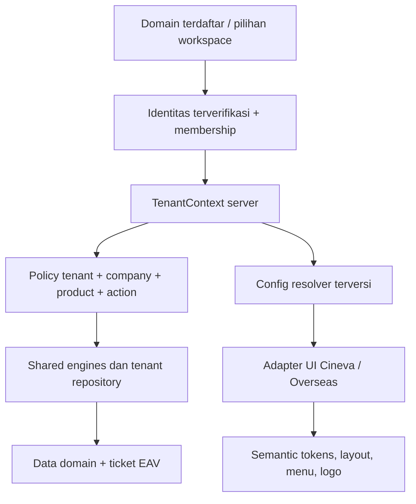

# Audit kesiapan SaaS Cineva dan Overseas

Tanggal: 21 Oktober 2026. Keputusan: **belum siap untuk multi-tenant SaaS dengan isolasi data yang dapat dijamin**. Fondasi modular, company context, EAV, adapter theme, dan prototipe subscription tersedia. Fondasi tersebut belum membentuk satu kontrak tenant yang wajib pada seluruh jalur frontend–backend.

Definisi pengguna terbaru: tenant = program (HOTS Normal, Overseas, Cineva), company = perusahaan (Indofood, IndoUSA), role pada membership user. [Standar SaaS/SSO terbaru](saas_standards_sso_2026_10_21.md) supersede interpretasi tenant-pelanggan pada rancangan historis berikut; temuan source tetap berlaku.

Update lanjutan: pengguna memilih HOTS actual sebagai target database Cineva. [Audit struktur/semantik dan snapshot target](database_saas_audit_2026_10_21.md) kini tersedia; pernyataan belum adanya physical DDL Cineva pada audit awal tetap merupakan batas evidence awal, bukan berarti schema target HOTS belum diperiksa.

## Ruang lingkup dan dampak arsitektur

Audit source Cineva frontend/backend dan pembanding Overseas host/PAR saat ini di `D:/Kantor/1.Frontend/overseas_base`, `overseas_module/par`, serta backend `app/modules/par-document`. Kantor hanya dibaca. Tidak ada edit aplikasi, koneksi DB, migration, billing/provider call, atau deployment. Lima pemeriksaan VM menjalankan controller asli dengan query stub; hasilnya membuktikan konstruksi query, bukan kebocoran historis atau exploit pada production. Ini audit terarah pada batas SaaS, bukan sertifikasi semua endpoint.

Usulan perubahan bersifat additive: shared HOTS engines tetap fondasi; `tenant-context`, policy/repository boundary, `tenant-config` dan branding renderer menjadi modul platform bersama. Cineva dan Overseas tetap memiliki adapter/policy/domain masing-masing. Kontrak EAV `cstm_col`, `lbl_col`, `value`, profile, work-data, approval dan assignment dipertahankan. Perubahan owning tenant tidak boleh hanya menjadi field EAV opsional atau filter UI. Pengembangan upstream Kantor memerlukan pekerjaan terpisah di project pemiliknya.

## Ringkasan kesiapan

Keputusan pengguna sesudah audit: **isolasi wajib hadir pada level package frontend dan backend**. Detail kontrak package di bawah menjadi syarat implementasi, belum klaim package sudah tersedia.

| Kemampuan | Status | Makna |
|---|---|---|
| Engine modular/form/workflow/config JSON | Fondasi tersedia | Dapat dipakai ulang, belum menjamin pemisahan pemilik data |
| Cineva HQ/Creator | Frontend/dummy dan domain existing | Integrasi tenant/payment nyata belum dibuktikan |
| Company scoping Overseas PAR | Tersedia pada jalur yang diperiksa | Otorisasi perusahaan/partisipan, belum kontrak tenant seluruh platform |
| Tenant isolation backend | Belum memadai | Query marketplace dan billing menunjukkan celah scope |
| Theme/logo JSON menyeluruh | Parsial | Vendor adapter statis dan field JSON tersedia terpisah |
| Subscription SaaS | Prototipe | Payment mock dan fallback company 1 |
| Operasi SaaS | Belum diverifikasi | Provisioning, entitlement enforcement menyeluruh, backup/restore tenant, revoke, quota dan deployment perlu acceptance |

## Bukti dan temuan

Sumber lengkap beserta baris dan SHA-256: `../reports/saas_audit_2026_10_21/evidence.json`. Excel mencantumkan semua 17 temuan, prioritas, tindakan dan lokasi source. P0 di sini berarti blocker sebelum penggabungan tenant, bukan klaim insiden produksi.

1. **A01 / P0 — Marketplace belum dipaksa scope tenant.** `JobManagementController.listJobs` hanya menambah kondisi search/status/visibility. `getJobDetail` mengambil core data dari `job_id` tanpa pemeriksaan company pada query awal. Token valid bukan bukti actor berhak atas job tersebut. Visibility public/internal/private harus dibedakan lewat policy yang eksplisit; jangan membuka seluruh listing secara implisit.
2. **A02 / P0 — Client dapat menentukan scope billing.** `CinevaBillingController` mendahulukan `req.query.company_id` atas token. `getReport` tanpa company menyusun agregat tanpa predicate company. Route menggunakan authGuard tetapi tidak menambahkan pemeriksaan membership pada controller yang diperiksa.
3. **A03–A05 / P0 — Identitas tenant belum satu kontrak.** `decodeTokenHT` memverifikasi JWT dan meneruskan payload; tidak menetapkan tenant membership. `engineTicket.create` mengambil company/creator dari body sebelum fallback token. Router Cineva/SaaS/marketplace memiliki `LOCAL_DISABLE_AUTH=1` dengan actor/company 1. Nilai environment production tidak dibaca dalam audit; ini jalur berisiko bila salah konfigurasi, bukan bukti bypass production aktif.
4. **A06 / P1 — Billing SaaS masih mock.** `CinevaSubscriptionController` memiliki beginTransaction/commit/rollback, tetapi token pembayaran dan payInvoice berlabel mock. Default Starter/trial serta company 1 tidak boleh dianggap onboarding/entitlement produksi. Pemeriksaan invoice sebelum beginTransaction perlu rancangan concurrency/idempotency. Kehadiran fitur subscription belum membuktikan provider pembayaran ataupun pembatasan semua fitur backend.
5. **A07–A09 / P1 — Theme belum berasal dari tenant JSON end-to-end.** `CinevaVendorTheme` menulis vendor `cineva` pada root; `App.tsx` membungkus app dengan adapter itu. `theme-provider.tsx` memaksa light. `core/loader.js` memang parse `theme_json`, tetapi lookup/cache hanya module_key. Pencarian source frontend tidak menemukan consumer `theme_json` pada cakupan yang diperiksa. `ServiceSettingsTab` menyediakan customCss; editor saja tidak membuktikan renderer aktif. Isi config database belum dibaca.
6. **A10 / P1 — Cache frontend perlu namespace.** `useWidgetData` memakai endpoint/params atau custom key, tanpa tenant/user otomatis. Ini berisiko pada pergantian konteks dengan endpoint/params identik; audit belum mereproduksi perpindahan akun di browser.
7. **A11–A12 / P0–P1 — Batas data di luar SQL belum lengkap.** `registerRoutes` memasang static public files/generateddocuments; klasifikasikan mana aset publik dan mana dokumen privat. Jangan mengklaim semua file sensitif tanpa inventaris konten. SSE manager mengelompokkan koneksi berdasarkan userId, belum tenant/user/channel. Satu user multi-tenant dapat menerima konteks silang bila policy emit tidak diperketat.
8. **A13 / P1 — Transaksi belum konsisten.** Module admin create/update memakai query helper tanpa explicit transaction boundary. Helper `config/db.js` menjalankan query pool; namanya tidak menjamin transaction. Router module admin diekspor, tetapi tidak terlihat dipasang di `app/registerRoutes.js` yang diperiksa. Karena itu temuan ini adalah gap implementasi/latent route, bukan klaim endpoint admin terbuka aktif.
9. **A14–A15 / P1–P0 — Overseas multi-company bukan otomatis multi-tenant.** Header menggunakan teks `OV`/`Overseas Portal` statis dan nama company dari session. PAR memiliki scope perusahaan dan akses participant/accounting; role 4 memiliki jalur admin setelah pemeriksaan confidentiality. List PAR juga mempunyai cabang admin dan cakupan multi-company. Policy bisnis ini perlu ditempatkan **di dalam batas tenant**, agar admin suatu tenant tidak mewarisi akses seluruh tenant.
10. **A16–A17 — DDL dan logo perlu sumber authoritative.** Knowledge Cineva menunjuk schema draft, tidak menyediakan physical DDL terverifikasi. Tidak ada SQL migration dibuat. `LogoBar` legacy mengimpor logo Indofood langsung; belum dibuktikan dipakai UI aktif. Logo shell/login/favicon/PDF/email harus diaudit consumernya satu per satu, bukan sekadar mengganti file ini.

## Kontrak package isolasi yang diwajibkan

Nama package berikut merupakan rancangan lokal Cineva; belum dipublikasikan, belum dibuat sebagai runtime package, dan tidak boleh dicatat sebagai capability aktif.

| Package usulan | Tanggung jawab | Batas |
|---|---|---|
| `@hots/tenant-contracts` | Contract context/config/error, schema version dan validasi format; dapat dipakai frontend dan backend | Tidak berisi secrets, koneksi DB atau keputusan otorisasi dari browser |
| `@hots/tenant-client` | Provider/context, bootstrap tenant dari server, lifecycle switch/revoke, namespace cache/storage, pembatalan request lama dan pengelolaan subscription | Context browser adalah state UI; server selalu memverifikasi ulang |
| `@hots/tenant-server` | Middleware context terverifikasi, membership/policy adapter, scoped repository/storage/job/event context dan audit | Context wajib untuk operasi privat; default deny, tanpa fallback tenant 1 |

Branding renderer memakai `ui-kit`/`app-core` existing dan config contract dari `tenant-contracts`; resolver dan publish backend dipasang melalui `tenant-server` dengan persistence adapter. Hindari menduplikasi engine theme, HTTP client, notification atau transaction yang sudah ada. Struktur package/contracts harus mengikuti workspace dan dependency graph existing saat implementasi.

Urutan dependency: contract netral → client/server → adapter engine/domain → aplikasi. Frontend tidak boleh mengimpor package server. Package server tidak bergantung pada React atau aturan bisnis Cineva/PAR. Pemilihan database terpisah atau shared tables disediakan persistence adapter, bukan cabang domain di package umum. DB-specific mapping menunggu DDL fisik terbaru.

Aturan konsumsi wajib:

1. Shell Cineva/Overseas dan remote MFE mengambil context dari provider yang sama dalam satu shell. Login/SSO serta permission server menentukan tenant aktif; state localStorage, URL dan header client tidak memberi hak akses.
2. `engine-client`, widget/form/report, cache, upload/download dan notification memakai scoped adapter. Request membawa pilihan konteks sesuai protokol server, tetapi backend mengikat konteks pada actor yang terautentikasi. Perpindahan tenant membatalkan request/subscription lama; respons terlambat tidak boleh mengisi cache tenant baru.
3. Backend engine/controller/repository/job worker mengonsumsi `tenant-server`; company, product dan permission selalu diperiksa di dalam tenant. Scoped API harus menolak operasi tanpa context. Raw SQL/pool global tidak boleh menjadi jalur bypass pada modul yang sudah dimigrasikan.
4. Repository generik tidak cukup sekadar menambahkan string WHERE. Adapter harus menjaga parent-child ownership, join, aggregate, batch, transaksi pada koneksi yang sama dan filter COUNT sebelum pagination. Platform admin lintas tenant merupakan capability eksplisit terpisah dan diaudit.
5. Job, event, file dan cache menyertakan context tervalidasi; consumer memeriksa kembali scope dan revocation sesuai policy. Public branding menggunakan API public khusus dengan field minimum; tidak melonggarkan API data privat.
6. Package harus diuji mandiri lalu diuji integrasinya pada consumer nyata. Keberadaan package atau lulus unit test tidak berarti semua endpoint legacy otomatis terisolasi. Daftar consumer yang belum dimigrasikan wajib terlihat sebelum aktivasi multi-tenant.

Acceptance package: tenant kosong/spoofed ditolak; dua tenant memakai resource ID sama tanpa benturan cache/storage; read/write/join/export lintas tenant ditolak; tenant admin tetap scoped; company/PAR participant policy terjaga; switch A→B tidak menerima respons/SSE A; rollback dan kegagalan sync tidak menghasilkan commit sukses; branding JSON tenant A tidak memakai asset tenant B. Acceptance aplikasi dilakukan setelah acceptance package dengan dua tenant fixture dan koneksi runtime yang sesuai.

## Pemisahan tenant, company, product dan brand

Bedakan empat konsep:

- **Tenant:** batas pelanggan, pemilik data dan otorisasi SaaS.
- **Company:** badan usaha/unit bisnis di dalam tenant. Satu tenant dapat memiliki banyak company.
- **Product:** Cineva atau Overseas, menentukan modul/policy/menu yang tersedia.
- **Brand:** presentasi untuk tenant/product, dapat mempunyai override company bila dibutuhkan.

Cineva dan Overseas adalah produk, bukan selalu dua tenant. Pelanggan Cineva A dan B harus terisolasi walaupun sama-sama memakai produk Cineva. Grup Overseas dapat memiliki beberapa company dan akses lintas company yang sah di tenant yang sama. Satu pelanggan yang berlangganan kedua produk tetap tidak otomatis berbagi semua data antarproduk; izin modul/resource harus eksplisit.

Alur target:



Host/domain yang diminta adalah petunjuk pemilihan workspace, bukan bukti izin. Registry host harus tervalidasi; header tenant bebas dari client tidak dapat menjadi sumber otorisasi. Login/SSO mengikat user, tenant aktif, membership dan versi izin; switch tenant menghasilkan konteks server baru dan membersihkan cache/in-flight request/UI state/SSE lama. Revocation harus efektif walaupun token lama belum expired. Nilai tenant kosong ditolak, tanpa default ke 1.

## Pilihan database

| Pola | Kesesuaian | Konsekuensi |
|---|---|---|
| Satu server MySQL, database/schema per tenant | Tahap transisi yang lebih konservatif untuk legacy sekarang | Credential/pool per tenant, allowlist mapping server-side, migration/backup lebih banyak |
| Satu database/schema, tabel bersama | Sasaran SaaS bila pengguna memerlukan shared tables | Semua akses wajib tenant scope; FK/unique/index perlu desain tenant-aware; biaya audit legacy paling tinggi |
| Hybrid | Platform registry bersama, data tenant terpisah atau pooled berdasarkan kebutuhan | Kompleksitas routing/provisioning lebih besar, memerlukan kontrak engine sama |

**Rekomendasi audit:** pakai satu ekosistem platform/cluster dan shared engine lebih dahulu; pertahankan pemisahan database tenant selama legacy belum lolos pengujian isolasi. Jika sasaran wajib satu database/tabel yang sama, jadikan penguatan tenant repository sebagai prerequisite sebelum pooling. Pemisahan database tidak berguna bila credential aplikasi tetap memiliki akses bebas ke semua database dan nama schema diambil dari client. Kredensial terpisah/least privilege dan penghapusan hardcoded cross-schema (`hots.*`, `iod.*`) dari jalur tenant diperlukan. Ini usulan, belum mapping fisik atau migration.

Untuk shared tables, setiap aggregate root harus memiliki ownership tenant yang authoritative. Child EAV/work-data/assignment/event harus diverifikasi melalui parent milik tenant yang sama, atau tenant key konsisten dengan constraint yang sesuai DDL. Jangan mengasumsikan semua child perlu kolom identik sebelum DDL diperiksa. Semua join, count, search, report, export, bulk action, background job, notification, upload/download dan raw SQL harus ikut kontrak. `company_id` existing tetap makna bisnis; tidak diganti massal menjadi tenant.

MySQL GRANT menyediakan level global/database/table/column/routine; tidak boleh dianggap otomatis menerapkan row policy tenant pada tabel bersama. Referensi: [MySQL GRANT](https://dev.mysql.com/doc/refman/8.0/en/grant.html). Pendekatan tenant context, membership, cache dan storage isolation sejalan dengan [OWASP Multi Tenant Security](https://cheatsheetseries.owasp.org/cheatsheets/Multi_Tenant_Security_Cheat_Sheet.html). Backend tetap mengotorisasi setiap request dari frontend/MFE: [OWASP Micro Frontend Security](https://cheatsheetseries.owasp.org/cheatsheets/Micro_Frontend_Security_Cheat_Sheet.html).

## Kontrak desain dan logo JSON yang diusulkan

Berikut contoh **kontrak aplikasi usulan**, bukan record database yang ditemukan, bukan physical schema dan bukan konfigurasi aktif. Tenant dipilih server; slug JSON ini tidak memberikan izin. Nilai warna mengikuti arah vendor Cineva existing, bukan hasil pembacaan DB.

```json
{
  "schema_version": 1,
  "revision": 1,
  "tenant_key": "pelanggan_cineva_a",
  "product_key": "cineva",
  "brand": {
    "display_name": "Cineva",
    "logo_light_asset_id": "cineva_logo_light",
    "logo_dark_asset_id": "cineva_logo_dark",
    "favicon_asset_id": "cineva_favicon",
    "logo_alt": "Cineva"
  },
  "theme": {
    "default_mode": "light",
    "allowed_modes": ["light", "dark"],
    "tokens": {
      "primary": "#CD9A36",
      "sidebar_background": "#483326",
      "background": "#FFF9EF"
    }
  },
  "layout": { "preset": "sidebar", "density": "comfortable" },
  "navigation": { "menu_config_key": "cineva_main" },
  "modules": ["campaign", "creator", "scheduling"]
}
```

Urutan resolver: HOTS defaults → product defaults → tenant override → company override yang diizinkan → preferensi user yang diizinkan. JSON berisi semantic tokens dan preset tervalidasi, bukan arbitrary executable JS atau CSS bebas. Asset ID diselesaikan server ke asset yang dimiliki tenant, menggunakan URL HTTPS/path yang diizinkan; aturan upload SVG/MIME perlu sanitization dan validasi. Brand assets yang sengaja public dipisah dari attachment privat. Config public sebelum login hanya memuat brand minimum, tanpa secrets/data pelanggan; admin config memerlukan permission tenant-scoped.

Alur edit: visual brand editor → validasi schema/token/asset ownership → preview draft → publish config dalam transaction → commit → invalidate cache/SSE tenant → renderer pakai revision baru. Simpan history dan pointer revision sebelumnya untuk rollback konfigurasi. Cache key memuat tenant/product/company/revision dan, untuk data berizin, identitas/versi izin. CDN/cache public brand juga harus memisahkan host/tenant. Menu dan daftar modules di JSON hanya presentasi; backend tetap memeriksa entitlement dan permission server.

Logo harus dikonsumsi dari contract yang sama pada shell, login, favicon, mobile, report, email dan PDF. Snapshot dokumen dapat menyimpan revision brand untuk reproduksi historis; perubahan brand hari ini tidak otomatis mengubah dokumen lama.

## Tahapan dan acceptance sebelum implementasi produksi

| Tahap | Hasil | Acceptance |
|---|---|---|
| 0. Inventaris fisik | DDL terbaru, daftar consumer/route/identity, owner tenant/company/product yang disepakati | Tidak ada mapping tenant ambigu; tidak menyamakan company dan tenant |
| 1. Tenant boundary | TenantContext, membership, scoped admin, bypass production guard, tenant repository | Tenant kosong/spoofed ditolak; tenant A tidak bisa baca/tulis resource B lewat ID/body/query/filter |
| 2. Persistence | Mapping roots/children, constraints/index, backfill, transaksi dan rollback | FK/unique lintas tenant ditolak; fault injection rollback; sync wajib gagal berarti tidak commit sukses |
| 3. Config/branding | Resolver, JSON schema, visual editor, version/publish/rollback, brand asset service | Dua tenant satu build menampilkan brand berbeda; invalid config/asset tenant lain ditolak; default HOTS tetap |
| 4. Domain dan kanal | Adapter Cineva/Overseas, policy PAR, export/report/files/jobs/SSE/cache | Read/write/list/count/search/export/upload/download/job/SSE tidak melampaui tenant; admin/participant lintas company hanya di tenant sah |
| 5. Operasional SaaS | Provisioning/suspend/revoke, entitlement/quota, provider payment, audit/backup/restore | Webhook signature dan replay/idempotency diuji; concurrent payment aman; suspend memblokir API; restore tidak menimpa tenant lain |

DB DML wajib transaction + commit + rollback pada koneksi yang sama. MySQL DDL memerlukan prosedur migration/backout tersendiri karena implicit commit; jangan menjanjikan rollback transaksi untuk seluruh DDL. Event perubahan bisnis terbit sesudah commit melalui logger/SSE existing, dengan tenant context. Isolated tests untuk audit ini bukan acceptance tahap-tahap di atas.

## Validasi audit dan file hasil

- Script: `3.Knowledge/scripts/saas_audit_2026_10_21/audit.mjs`.
- Lima reproduksi terisolasi: listing marketplace tanpa scope, query company billing mengungguli token, report tanpa company, subscription fallback company 1, detail job dengan job_id saja.
- `evidence.json` memuat 17 temuan dan baris/hash source aktual; stub tidak terhubung ke database dan tidak mengimpor runtime aplikasi.
- Excel: `3.Knowledge/reports/saas_audit_2026_10_21/outputs/saas_audit_2026_10_21/SaaS_Readiness.xlsx`.
- Production schema/records, HTTP authorization nyata, akses storage deployment, browser tenant switch dan provider payment belum diverifikasi. Dibutuhkan physical DDL Cineva terbaru di knowledge untuk melanjutkan desain SQL; audit ini tidak menebak schema dari controller/draft.
